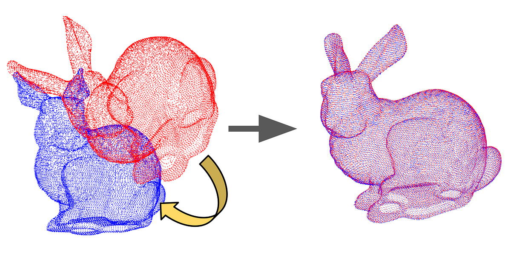
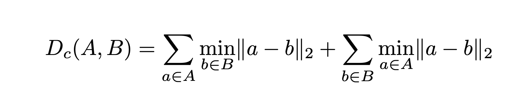

# Point Cloud Registration


***This class activity is to be done as individuals, not with partners nor with teams.***

### How to get started →

Begin by reading this entire writeup and making sure you have a good understanding of it. Next, spend some time planning how you’re going to approach the problem. 

## Introduction

---

In this class activity, you will implement a ICP matching to align two point clouds and create a stitched point cloud. The goal is to align the two point clouds by finding the transformation that minimizes the distance between the two point clouds.



Point clouds are provided and are of two types : `source` and `target`. The `source` point cloud is the point cloud that needs to be aligned with the `target` point cloud. We will provide you with various point clouds to test your implementation.

Finally, you will evaluate the quality of your aligned point cloud with the reference provided by us.
## Activity Information

---

### Objectives

- Understand how point cloud registration works
- Learn how to implement ICP matching
- Compute difference between two point clouds by calculating the Chamfer distance

### Resources

- [Location 0/1 Plys](https://buffalo.box.com/s/tdcjspsf2nksfb480va4ld5xs4ht849g)
- [CloudCompare](https://cloudcompare-org.danielgm.net/release/)
- [Open3D](https://www.open3d.org/docs/release/)
- [Open3D ICP Matching](https://www.open3d.org/docs/release/tutorial/pipelines/icp_registration.html)
- [Open3D Global Registration](https://www.open3d.org/docs/release/tutorial/pipelines/global_registration.html)
- [Chamfer Distance (Section II.D.1)](https://arxiv.org/abs/2306.03660v2)

### Requirements

- Your code should execute without any errors
- Your code should execute within a reasonable time frame

### What we provide
- `align.py`: Contains imports for parsing arguments. You may include any other required libraries (open3d, numpy, scipy, etc)
- `evaluate.py`: Contains the `chamfer_distance` function that prints the distance value
- Sample point clouds to test your implementations
  - Bunny source and target point clouds - use this to test alignment
    - The bunny source point cloud is the point cloud that needs to be aligned with the bunny target point cloud
    - Once aligned, your aligned point cloud should look like the bunny target point cloud
  - Location 0 and 1 point clouds - use this to test alignment and evaluation (Do not submit these files. We will add the files during grading)
    - The location 0 and 1 point clouds are LiDAR scans taken at two different locations (a few meters apart)
    - Align the location 0 point cloud with the location 1 point cloud
    - Once aligned, the aligned location 0 point cloud should look like the location 1 point cloud
    - Merge the aligned location 0 and 1 point clouds to create a stitched point cloud
    - Use `aigned_locations.ply` to evaluate the quality of your aligned point cloud

### What to submit

You must submit the repo with the following structure: **Do not submit the result ply files as you will get size errors in autolab**

```bash
pointcloud_registration
├── input
│   └── bunny_source.ply # Source point cloud
│   └── bunny_target.ply # Target point cloud
├── result # Folder to save the ply files. Do not submit any ply files inside it
│   └── dummy.txt # Dummy file that allows github to publish folders
├── align.py # Main script to align point clouds 
└── evaluate.py # Script to evaluate the quality of the aligned point cloud
```

Your `align.py` script should take the source and target point clouds as input and **output the aligned point cloud**. Your `evaluate.py` script should take the aligned point cloud and the reference point cloud as input and output the Chamfer distance between the two point clouds.

Example usage:
```
python3 align.py --source input/bunny_source.ply --target input/bunny_target.ply --output result/bunny_aligned.ply
```
```
python3 evaluate.py --candidate result/bunny_aligned.ply --reference input/bunny_target.ply
```
*Please make sure you adhere to the structure above, if your package doesn’t match it the grader will give you a **zero***

### Grading considerations

- **Late submissions:** Carefully review the course policies on submission and late assignments. Verify before the deadline that you have submitted the correct version.
- **Environment, names, and types:** You are required to adhere to the names and types of the functions and modules specified in the release code. Otherwise, your solution will receive minimal credit.

## Point Cloud Visualization
You can visualize PointCloud files (PLY) using CloudCompare. Install it from the snap store [here](https://snapcraft.io/cloudcompare). Run the cloudcompare executable (not the viewer) in your VM, drag the `bunny_source.ply` file to central window and click apply all. You should see a blue pointcloud. You can also import the other PLY files.


### Part 1: Point Cloud Alignment
---

### Coarse Alignment

Coarse alignment is the initial step in aligning two point clouds, aiming to find an approximate transformation that brings them closer together. This can be achieved through techniques like RANSAC, which iteratively identifies correspondences between points and estimates a transformation based on these matches, or feature matching, where distinctive features are identified and aligned across the clouds.  This rough alignment serves as a starting point for more precise fine-alignment methods. 


### Fine Alignment (ICP Matching)

Following coarse alignment, the next crucial step is fine alignment. While coarse alignment provides an initial estimate of the transformation between point clouds, it often lacks precision. Fine alignment refines this estimate by employing more sophisticated techniques that consider the full set of points and minimize geometric discrepancies. For this, we will use the Iterative Closest Point (ICP) algorithm, a widely-used method for point cloud registration.


### Plan of attack (Optional)

1. **Load the point clouds**: Load the source and target point clouds using Open3D.
2. **Coarse alignment**: Perform coarse alignment using RANSAC or feature matching.
3. **Fine alignment**: Implement the ICP algorithm to refine the transformation between the point clouds.
4. **Save the aligned point cloud**: Save the aligned point cloud to a file.


### Part 2: Point Cloud Evaluation
---
### Chamfer Distance

The Chamfer distance is a metric used to evaluate the similarity between two point clouds. It measures the distance between each point in one cloud and its nearest neighbor in the other cloud. A lower Chamfer distance indicates a better alignment between the point clouds.



Where, *Dc* is the Chamfer distance, A and B are the two point clouds. For each point in A, we find the nearest neighbor in B and vice versa. The distance between each pair of points is calculated and summed to get the Chamfer distance.

**Note: You may not use any libraries that directly compute Chamfer distance. You must write your own chamfer distance function. Use datastructures **

### Suggested Plan Of Attack 
1. **Load the point clouds**: Load the aligned point cloud and the reference point cloud.
2. **Calculate the Chamfer distance**: Compute the Chamfer distance between the two point clouds. Use efficient data structures to speed up calculations.
3. **Output the result**: Print the Chamfer distance to the console.

## Submission and Assessment

---

Submit your code using the Github upload feature on [autolab](https://autolab.cse.buffalo.edu). 
**Do not submit the ply files**

**Note: Make sure your code complies to all instructions, especially the naming conventions. Failure to comply will result in zero credit.**

You will be graded on the following. Penalties are listed under each point, absolute values, w.r.t activity total.

1. Point Cloud Alignment (50%)
2. Point Cloud Evaluation (50%)

